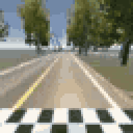
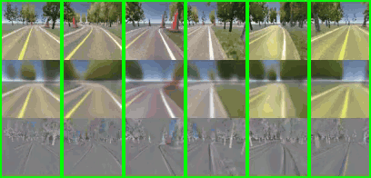
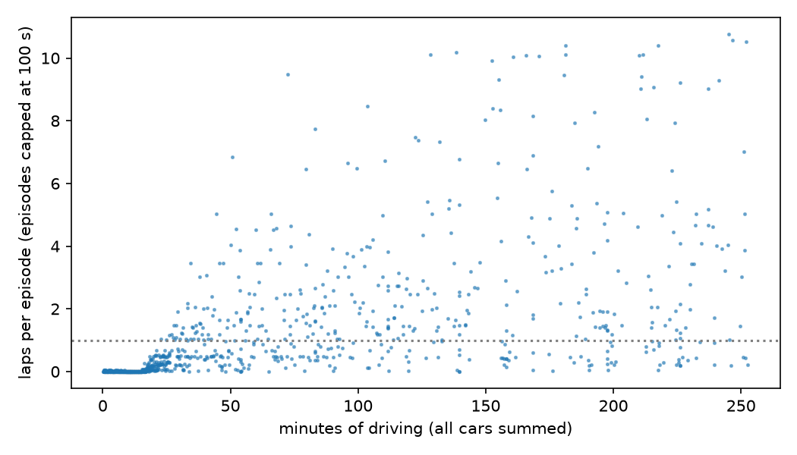

# DreamerV3 on the Donkey Car simulator

A simulated Donkey Car learns to lap `generated-track` from its 64x64 front camera, using stock DreamerV3
(world model trained on real simulator steps, actor and critic trained on imagined rollouts).
Run on 2026-11-21 on one MI350X (`asrock-1w300-f1-1`), JAX 0.12 on ROCm, simulators rendering on the CPU.

| The trained car's own view (run 2) | World model: real frames, predicted frames, difference |
|---|---|
|  |  |

In the right-hand clip each column is one stretch of driving. The model sees the first half and imagines the
second half from the actions alone; it keeps the road shape and loses detail in the trees.

## Result: run 2 (`donkey_p1`, seed 0, 300k steps, 8 cars, about 46 minutes of wall time)

Changes from run 1: each car reloads its scene every 3 minutes (new trees, cones and lighting), the off-track
limit is `max_cte` 3.0 instead of 4.0, and 8 cars instead of 4.

| | Steps | Minutes of driving (8 cars summed) |
|---|---|---|
| First episode with a full lap | 27,189 | 22.7 |
| First episode with 5 laps | 53,517 | 44.6 |
| First episode with 10 laps | 154,002 | 128.3 |

- **Evaluation on four simulators started after training, so on scenes the agent had never seen: 8 of 8
  episodes completed 10 consecutive laps.** The simulator's own start-line counter also read 10 in each. No
  collisions, and the car stayed within 1.9-2.25 of the centre line against a limit of 3.0. A lap takes about
  222 steps (11.1 s).
- Training episodes were much less consistent than this (many end within 100 steps even late in the run).
  Not investigated. Two differences from evaluation: training runs 8 cars with step time averaging 0.065 s
  instead of 0.05 s, so some frames are dropped, and the learner ran at about 7,500 replayed steps/s against
  the 10,000 that 8 cars at train ratio 64 ask for.
- Full outputs in `runs/report_p1/` (git-ignored). Laps per training episode against driving time:



## Result: run 1 (`donkey_p0`, seed 0, 300k steps, 4 cars, about 68 minutes of wall time)

Same setup with `max_cte` 4.0 and no scene reloads. It learned faster but only for the scenes it trained on.

| | Steps | Minutes of driving (4 cars summed) |
|---|---|---|
| First episode with a full lap | 21,431 | 17.9 |
| First episode with 10 laps | 71,109 | 59.3 |

- Training episodes are capped at 100 s; from about 60 minutes of driving on, most reach the cap at 11-12 laps.
- Evaluation of the final checkpoint **on the same four simulator instances it trained on** (stochastic policy,
  episode ends at 10 laps or when the car leaves the track): 8 of 14 episodes completed 10 consecutive laps.
  The other six ended off the track after 0.3, 2.9, 6.8, 8.8, 8.9 and 9.1 laps.
- **On freshly started simulators the same checkpoint fails** (runs `donkey_p0_lapcheck*`, `donkey_p0_hitcheck*`,
  five fresh simulators, about 115 episodes): most episodes end after about 0.55 or about 1.1-1.2 laps; the
  best reached 6.2 laps.
  - Every one of these ended on the off-track rule (`cte` above 4.0). The simulator reported no collision in
    any of them (`log/hit` was 0 throughout), so cones are not what ends the episodes.
  - On the training instances the car's normal line already runs at `cte` 3.5-3.9 in the 10-lap episodes,
    0.1-0.5 inside the limit, so a small change is enough to put it over.
  - What changes on a fresh start is not established. The simulator regenerates trees, cone positions and
    lighting each time it starts, and training never restarted it, so each car saw one version of the scene.
    That is the likely cause, but it was not isolated. (Average speed was lower on fresh simulators only
    because short episodes are dominated by the standing start: 2.4 at 0.5 laps, 3.1 at 6 laps, the same as
    the 10-lap runs.)
- Outputs in `runs/report_p0/` (git-ignored): `curve.png`, `drive_before.mp4`, `drive_after.mp4` (the agent's
  own 64x64 view) and `dream.mp4` (per column: real frames, world-model prediction, difference).

Laps are counted from the simulator's track-node progress (`activeNode`, 108 nodes per lap), not from
finish-line crossings. Cross-check against the simulator's own start-line counter (`log/sim_laps`), on the
fresh simulators: our counter read 1.1-1.2, 2.1-2.2 and 6.2 laps when the simulator had counted 1, 2 and 6,
with a simulator lap time of 9.2 s. The constant offset is the distance from the start position to the line.
The 10-lap episodes were not re-measured (the simulator's counter was added to the log after that evaluation).
In those episodes a lap took about 166 steps (8.3 s) by our counter.

## Setup

- Reward: +100 per lap of forward progress, -10 when the simulator ends the episode (more than `max_cte` from
  the centre line, or a collision). Steering -1..1, throttle 0.2..0.6.
- Model `size12m`, train ratio 64, cars at 20 Hz, `--script parallel --run.actor_batch 1 --run.eval_envs 0`.
  The `donkey` config block holds the run 2 settings (8 cars, `max_cte` 3.0, `reload_seconds` 180).
- DreamerV3 `e01491f` plus `patches/dreamerv3.patch`; gym-donkeycar `a1f4ca6`; simulator release `v25.10.06`.

## Reproduce

```bash
export LOGIN=a4 JOB=<slurm job> NODE_DIR=/home/AMD/absheikh/donkey-worldmodel
bash scripts/sync_node.sh
ssh a4 "srun --jobid=$JOB --overlap -n1 --chdir=$NODE_DIR bash scripts/setup_node.sh"
bash ../fpv-racing/scripts/node_step.sh sims 124 <<'EOF'
exec bash scripts/sims.sh 9200 8
EOF
bash ../fpv-racing/scripts/node_step.sh train_p1 124 <<'EOF'
export PYTHONUNBUFFERED=1 XLA_PYTHON_CLIENT_PREALLOCATE=false
C=/tmp/absheikh_donkey/cache
export JAX_COMPILATION_CACHE_DIR=$C/jax MIOPEN_USER_DB_PATH=$C/miopen MIOPEN_CUSTOM_CACHE_DIR=$C/miopen
mkdir -p $C/jax $C/miopen && cd dreamerv3
exec ../.venv/bin/python dreamerv3/main.py --logdir ../runs/donkey_p1 --configs donkey size12m --seed 0 \
  --script parallel --run.actor_batch 1 --run.eval_envs 0
EOF
```

The `parallel` script does not exit at `run.steps`; stop the step once `metrics.jsonl` passes the target.
Evaluate on simulators restarted after training, with one `--script eval_only --run.envs 1 --run.debug True`
process per simulator (`--env.donkey.port_base 920x --env.donkey.length 20000 --env.donkey.max_laps 10
--env.donkey.reload_seconds 0`), then
`python scripts/report.py runs/donkey_p1 runs/report_p1 --eval runs/donkey_p1_eval*`.

## Things that had to be worked around

- **Lockstep training loop.** DreamerV3's default `train` script steps all cars together. The simulator runs in
  real time and cannot pause, and a reset takes over a second, so the other cars drove blind and crashed
  (episodes of 4-6 steps). The `parallel` script with `actor_batch 1` serves each car on its own.
- **JAX 0.12.** Six `jax.jit` calls passed shardings positionally; the JAX profiler hangs on ROCm and is off.
- **Headless Unity.** Runs in Docker under Xvfb with Mesa llvmpipe. `xvfb-run` hangs as a container's first
  process, so `sims.sh` starts Xvfb directly. Default graphics quality gave 8.5 steps/s; "Very Low" gives 20.
- **Ports.** Every simulator also binds a private API on 9092, and the nodes use 9100, 9103 and 9110.
- **Scene reload.** `exit_scene` followed by a new connection reloads the scene. Reconnecting within about 3 s
  starts the car in a second start slot off the centre line; the environment waits 6 s and retries.

## Known limitations

- **Control delay.** The simulator renders about 10 frames per second and computes two 50 ms control steps per
  frame. Camera frames are distinct and 50 ms apart in simulated time, but about every other action takes
  effect one step late. Faster rendering would remove this.
- **Run 1 against run 2 is not a controlled comparison.** Three things changed together (scene reloads,
  `max_cte`, number of cars), so which one fixed the fresh-simulator failure is not known.
- One seed, one track, no baseline (PPO or imitation) yet.
