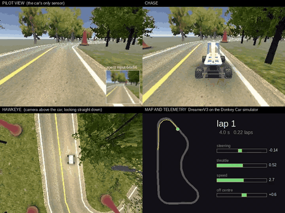
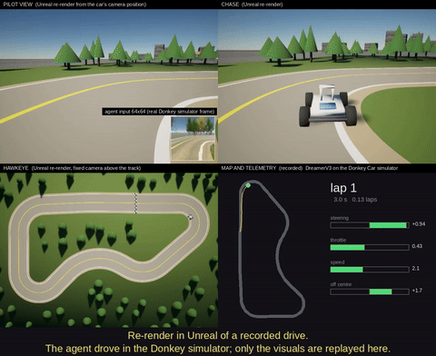
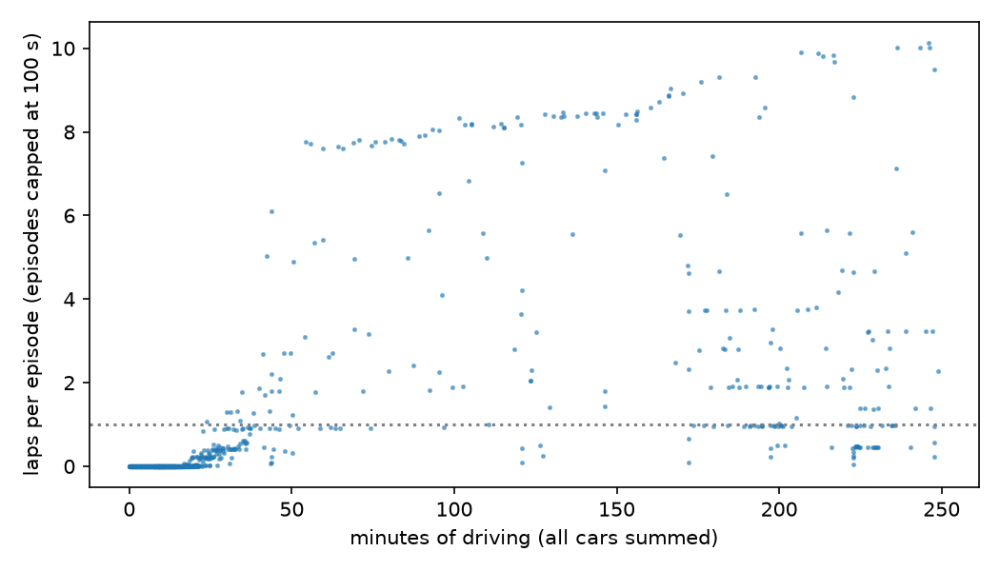

# DreamerV3 on the Donkey Car simulator

A simulated Donkey Car learns to lap `generated-track` from its 64x64 front camera, using stock DreamerV3
(world model trained on real simulator steps, actor and critic trained on imagined rollouts).
Run on 2026-11-21 on one MI350X (`asrock-1w300-f1-1`), JAX 0.12 on ROCm, simulators rendering on the CPU.



The run 4 agent on a simulator started after training (8 s of a 5-lap drive). The drive is recorded with the
agent's normal camera only; the three camera views are then filmed at 512x384 by putting a car back at each
recorded position in the same scene. Top: the car's camera position, with the 64x64 image the agent actually
received during the drive inset, and a chase camera. Bottom: a camera above the car, and the track centre
line with the car's path, steering and throttle.



The same recorded drive re-rendered in Unreal (Project AirSim Blocks) for clearer visuals. This is a replay
of the recorded poses on a rebuilt copy of the track: the agent never saw these images, and the inset shows
the real 64x64 Donkey frame it drove from. The hawkeye view is a fixed camera above the whole track, turned
90 degrees relative to the map panel. Scenery, lighting and the car model are not the Donkey simulator's.


The world model, 64x64. Each column is one stretch of driving: real frames, the model's prediction, and the
difference. The model sees the first half and imagines the second half from the actions alone; it keeps the
road shape and loses detail in the trees.

## Result: run 4 (`donkey_p3`, seed 0, 300k steps, 6 cars, about 52 minutes of wall time)

The run made to drive smoothly. Changes from run 2:
- steering goes through a low-pass filter (each step the wheel covers 30% of the gap to the request) and can
  move at most 0.2 per step;
- moving the wheel costs reward (0.5 per unit of applied movement);
- evaluation uses the policy's mean action (DreamerV3 samples even in its eval mode; patched);
- training ends an episode 2.5 from the centre line, evaluation at 3.0, so the learned line keeps a margin;
- the simulator's random on-road cones are off (they are pass-through triggers, and earlier agents drove
  through them), scenes reload every 90 s, and 6 cars.

| | Steps | Minutes of driving (6 cars summed) |
|---|---|---|
| First episode with a full lap | 28,659 | 23.9 |
| First episode with 5 laps | 50,679 | 42.2 |
| First episode with 10 laps | 283,568 | 236.3 |

- **Evaluation on four simulators started after training: 12 of 12 episodes completed 10 consecutive laps**,
  no collisions, never more than 2.31 from the centre line (limit 3.0). A lap takes about 188 steps (9.4 s).
- Steering on a recorded 5-lap drive, each agent with its own evaluation settings:

| | Mean wheel movement per step | Largest step | Direction reversals per second |
|---|---|---|---|
| Run 2 (sampled actions, no limits) | 0.618 | 2.00 | 6.3 |
| Run 3 (rate limit, weak cost) | 0.116 | 0.20 | 6.6 |
| Run 4 | 0.069 | 0.20 | 3.1 |

  Run 4 steers in ramps into and out of corners. The remaining reversals are ripples of about 0.03-0.05.
- Training episodes are again less consistent than evaluation (sampled actions, and a 2.5 limit).



## Result: run 3 (`donkey_p2`, seed 0, 300k steps, 6 cars)

Rate limit of 0.2 per step and a cost of 0.1 on the requested steering change, no filter. Not smooth (table
above): the cost was too weak and mostly taxed the noise of sampled actions. On fresh simulators three scenes
worked (8 of 9 episodes reached 10 laps) and one mostly failed (1 of 14), running 2.5-2.9 from the centre
line against a limit of 3.0.

## Result: run 2 (`donkey_p1`, seed 0, 300k steps, 8 cars, about 46 minutes of wall time)

Changes from run 1: each car reloads its scene every 3 minutes (new trees, cones and lighting), the off-track
limit is `max_cte` 3.0 instead of 4.0, and 8 cars instead of 4.

| | Steps | Minutes of driving (8 cars summed) |
|---|---|---|
| First episode with a full lap | 27,189 | 22.7 |
| First episode with 5 laps | 53,517 | 44.6 |
| First episode with 10 laps | 154,002 | 128.3 |

- **Evaluation on four simulators started after training, so on scenes the agent had never seen: 8 of 8
  episodes completed 10 consecutive laps.** The simulator's own start-line counter also read 10 in each. No
  collisions, and the car stayed within 1.9-2.25 of the centre line against a limit of 3.0. A lap takes about
  222 steps (11.1 s).
- Training episodes were much less consistent than this (many end within 100 steps even late in the run).
  Not investigated. Two differences from evaluation: training runs 8 cars with step time averaging 0.065 s
  instead of 0.05 s, so some frames are dropped, and the learner ran at about 7,500 replayed steps/s against
  the 10,000 that 8 cars at train ratio 64 ask for.
- Full outputs in `runs/report_p1/` (git-ignored).

## Result: run 1 (`donkey_p0`, seed 0, 300k steps, 4 cars, about 68 minutes of wall time)

Same setup with `max_cte` 4.0 and no scene reloads. It learned faster but only for the scenes it trained on.

| | Steps | Minutes of driving (4 cars summed) |
|---|---|---|
| First episode with a full lap | 21,431 | 17.9 |
| First episode with 10 laps | 71,109 | 59.3 |

- Training episodes are capped at 100 s; from about 60 minutes of driving on, most reach the cap at 11-12 laps.
- Evaluation of the final checkpoint **on the same four simulator instances it trained on** (stochastic policy,
  episode ends at 10 laps or when the car leaves the track): 8 of 14 episodes completed 10 consecutive laps.
  The other six ended off the track after 0.3, 2.9, 6.8, 8.8, 8.9 and 9.1 laps.
- **On freshly started simulators the same checkpoint fails** (runs `donkey_p0_lapcheck*`, `donkey_p0_hitcheck*`,
  five fresh simulators, about 115 episodes): most episodes end after about 0.55 or about 1.1-1.2 laps; the
  best reached 6.2 laps.
  - Every one of these ended on the off-track rule (`cte` above 4.0). The simulator reported no collision in
    any of them (`log/hit` was 0 throughout), so cones are not what ends the episodes.
  - On the training instances the car's normal line already runs at `cte` 3.5-3.9 in the 10-lap episodes,
    0.1-0.5 inside the limit, so a small change is enough to put it over.
  - What changes on a fresh start is not established. The simulator regenerates trees, cone positions and
    lighting each time it starts, and training never restarted it, so each car saw one version of the scene.
    That is the likely cause, but it was not isolated. (Average speed was lower on fresh simulators only
    because short episodes are dominated by the standing start: 2.4 at 0.5 laps, 3.1 at 6 laps, the same as
    the 10-lap runs.)
- Outputs in `runs/report_p0/` (git-ignored): `curve.png`, `drive_before.mp4`, `drive_after.mp4` (the agent's
  own 64x64 view) and `dream.mp4` (per column: real frames, world-model prediction, difference).

Laps are counted from the simulator's track-node progress (`activeNode`, 108 nodes per lap), not from
finish-line crossings. Cross-check against the simulator's own start-line counter (`log/sim_laps`), on the
fresh simulators: our counter read 1.1-1.2, 2.1-2.2 and 6.2 laps when the simulator had counted 1, 2 and 6,
with a simulator lap time of 9.2 s. The constant offset is the distance from the start position to the line.
The 10-lap episodes were not re-measured (the simulator's counter was added to the log after that evaluation).
In those episodes a lap took about 166 steps (8.3 s) by our counter.

## Setup

- Reward: +100 per lap of forward progress, minus the steering cost, -10 when the simulator ends the episode
  (more than `max_cte` from the centre line, or a collision). Steering -1..1, throttle 0.2..0.6.
- Model `size12m`, train ratio 64, cars at 20 Hz, `--script parallel --run.actor_batch 1 --run.eval_envs 0`.
  The `donkey` config block and `scripts/sims.sh` hold the run 4 settings.
- DreamerV3 `e01491f` plus `patches/dreamerv3.patch`; gym-donkeycar `a1f4ca6`; simulator release `v25.10.06`.

## Reproduce

```bash
export LOGIN=a4 JOB=<slurm job> NODE_DIR=/home/AMD/absheikh/donkey-worldmodel
bash scripts/sync_node.sh
ssh a4 "srun --jobid=$JOB --overlap -n1 --chdir=$NODE_DIR bash scripts/setup_node.sh"
bash ../fpv-racing/scripts/node_step.sh sims 124 <<'EOF'
exec bash scripts/sims.sh 9200 6
EOF
bash ../fpv-racing/scripts/node_step.sh train_p3 124 <<'EOF'
export PYTHONUNBUFFERED=1 XLA_PYTHON_CLIENT_PREALLOCATE=false
C=/tmp/absheikh_donkey/cache
export JAX_COMPILATION_CACHE_DIR=$C/jax MIOPEN_USER_DB_PATH=$C/miopen MIOPEN_CUSTOM_CACHE_DIR=$C/miopen
mkdir -p $C/jax $C/miopen && cd dreamerv3
exec ../.venv/bin/python dreamerv3/main.py --logdir ../runs/donkey_p3 --configs donkey size12m --seed 0 \
  --script parallel --run.actor_batch 1 --run.eval_envs 0
EOF
```

The `parallel` script does not exit at `run.steps`; stop the step once `metrics.jsonl` passes the target.
Evaluate on simulators restarted after training, with one `--script eval_only --run.envs 1 --run.debug True`
process per simulator (`--env.donkey.port_base 920x --env.donkey.length 20000 --env.donkey.max_laps 10
--env.donkey.reload_seconds 0 --env.donkey.max_cte 3.0`), then
`python scripts/report.py runs/donkey_p3 runs/report_p3 --eval runs/donkey_p3_eval*`.

Demo video: run one `eval_only` process with `--env.donkey.record <folder>` (saves the agent's camera
frames, telemetry, poses and the track without touching the cameras), then
`python scripts/replay_views.py --port <port> --record <folder>` on the same simulator before it is
restarted (films pilot, chase and overhead views at 512x384 from the recorded poses, about 10 minutes).
Copy the folder down and run `python scripts/make_video.py <folder> demo.mp4`. An earlier version filmed
two extra cameras during the drive itself; that slowed the simulator to about 6 steps/s and left small
jumps in the recording.

Unreal re-render of that folder (needs a node where Unreal renders offscreen; here 2x RTX PRO 4000 with the
Blocks build from `../fpv-racing/scripts/setup_airsim.sh`; the AMD cards crash in Vulkan start-up):
`scripts/unreal_render.py --record <folder> --out <frames> --instances 3 --gpus 0,1` on the node, copy the
frames down, then `scripts/make_unreal_video.py <folder> <frames> demo_unreal.mp4`. The track is built from
the 108 centre-line points at 1 Donkey unit = 1 m. Road geometry, measured from the simulator source and
confirmed on the overhead frames to about 0.1 units: 10 wide, its middle 2 to the left of the centre-line
path, white lines 4.05 either side of the middle, yellow line on the middle. It reuses the model builders,
simulator launch and lock-step capture of `../fpv-racing/fpv/render_airsim.py`. About 90 frames/s per view.

## Things that had to be worked around

- **Lockstep training loop.** DreamerV3's default `train` script steps all cars together. The simulator runs in
  real time and cannot pause, and a reset takes over a second, so the other cars drove blind and crashed
  (episodes of 4-6 steps). The `parallel` script with `actor_batch 1` serves each car on its own.
- **JAX 0.12.** Six `jax.jit` calls passed shardings positionally; the JAX profiler hangs on ROCm and is off.
- **Headless Unity.** Runs in Docker under Xvfb with Mesa llvmpipe. `xvfb-run` hangs as a container's first
  process, so `sims.sh` starts Xvfb directly. Default graphics quality gave 8.5 steps/s; "Very Low" gives 20.
- **Ports.** Every simulator also binds a private API on 9092, and the nodes use 9100, 9103 and 9110.
- **Scene reload.** `exit_scene` followed by a new connection reloads the scene. Reconnecting within about 3 s
  starts the car in a second start slot off the centre line; the environment waits 6 s and retries.

## Known limitations

- **Control delay.** The simulator renders about 10 frames per second and computes two 50 ms control steps per
  frame. Camera frames are distinct and 50 ms apart in simulated time, but about every other action takes
  effect one step late. Faster rendering would remove this.
- **The runs are not controlled comparisons.** Several things changed between each pair, so which change
  fixed what is not known. In particular run 3's failing scene was not explained.
- **Scenery cones remain.** Cones beside the road come from the same generator as the trees (never closer
  than 5 units to the centre line); only the on-road cones are off.
- One seed, one track, no baseline (PPO or imitation) yet.
