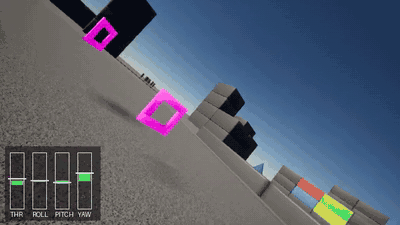
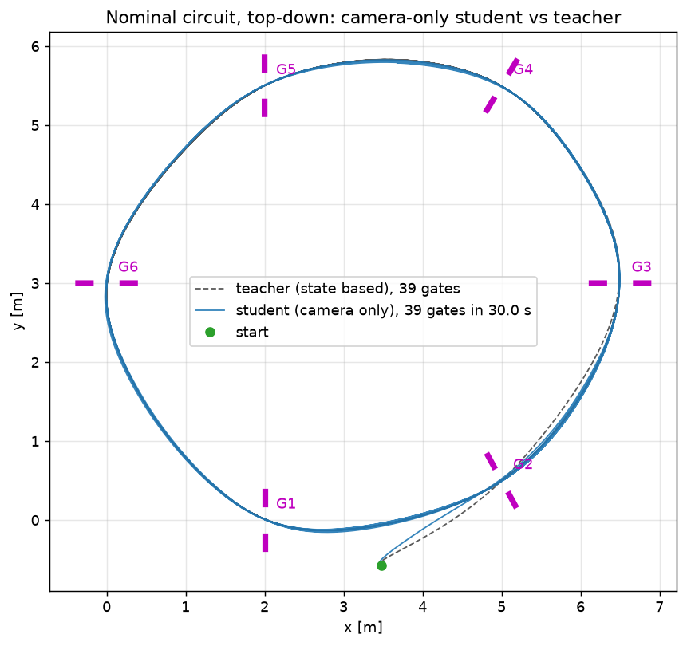
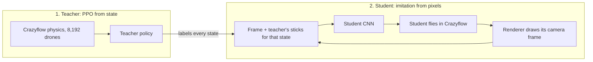

# FPV gate racing: PPO teacher, camera-only student

Goal: a network that races a quadrotor through gates from the FPV camera image alone, outputting the four stick
commands a human pilot sends (thrust and roll / pitch / yaw rate). Everything is simulation.

**Models and video:** https://huggingface.co/Abuudiii/fpv-gate-racing



The student's own view in Unreal. Bars: the sticks it commands; white tick: what the teacher would have done.

## Result

Closed loop in Unreal, student alone, 20 s per episode. The teacher flies the same layouts, physics and spawns.

| Pilot | Input | Randomised: ≥ 3 laps (192 held-out episodes) | Crashes | Lap time | Nominal circuit: ≥ 3 laps (24 episodes) |
|---|---|---|---|---|---|
| Student | 3 camera frames + its previous action | 95.8% (184) | 4.2% (8) | 4.60 s | 100% |
| Teacher | exact state (43 numbers) | 100% | 0% | 4.59 s | 100% |

"Randomised" draws a new gate layout (±0.3 m, ±0.2 rad per gate), mass, thrust, drag and command delay per episode.
All 8 student crashes are gate-frame hits; 7 happen in the first 4 seconds, before the third gate. The evaluation ran
216 randomised episodes (96.3% with three laps); the first 24 repeat the seed of an earlier evaluation whose flights
went into the training data, so the table leaves them out.



## How it works

PPO never sees a camera frame. A teacher learns to fly from exact state with PPO, and a CNN student then learns to
copy it from pixels by supervised learning.



| Piece | File | What it does |
|---|---|---|
| Physics | `fpv/env.py` | Gate-racing environment on [Crazyflow](https://github.com/learnsyslab/crazyflow) (batched JAX quadrotor sim, Crazyflie-class `cf21B_500`), 500 Hz physics, 50 Hz policy. It is the only dynamics in every stage. |
| Teacher | `fpv/ppo.py` | PPO in JAX. Input: velocity, attitude, body rates, corners of the next two gates, previous action. MLP 3 × 256. |
| Closed loop | `fpv/closed_loop.py` | Steps Crazyflow for an outside pilot and returns the teacher's action for the current state (the label). |
| Renderers | `fpv/render_airsim.py`, `fpv/render_synth.py` | Draw the FPV frame for a given pose. [Project AirSim](https://github.com/iamaisim/ProjectAirSim) (Unreal Engine 5, 24 instances on 6 GPUs) or a fast JAX ray caster. Neither does any physics. |
| Student | `fpv/student.py` | CNN, 2.43 M parameters. Input: last three 320×180 frames + its previous action. |
| DAgger | `fpv/dagger.py` | The student flies, drifts into states the teacher never visits, the teacher labels them, the student is retrained. |

Design choices that mattered:

- **Rate commands.** The policy outputs thrust + body rates, the interface FPV pilots and Betaflight use. Crazyflow's
  `body_rate` mode also levels the drone; the environment zeroes those gains (`kR`, `ki_m`), and
  `checks/crazyflow_check.py` tests the step response.
- **A teacher that tolerates a bad pilot.** The first teacher scored 100% on its own but crashed 3.4 times per
  flight-minute under moderate stick noise. Training with off-course starts and action noise cut that to 0.04, which
  is what makes its labels useful once the student drifts.
- **Synthetic pre-training.** Closed loop, Unreal renders about 90 frames/s across six GPUs here; the ray caster
  renders about 2,500 at the same resolution on one. The student learned to fly on the ray caster first. With the same first 171,000 Unreal frames, the pre-trained network
  completed three laps in 24 of 24 test episodes and one trained from scratch in none.
- **Lock-step rendering.** `scripts/test_render_airsim.py` checks that every frame belongs to the pose that was sent
  (0 mismatches in 32,000 frames under load) and that gates appear where the camera model predicts.

## Setup

One node with 6× H100 and 96 cores. Python 3.12.

```bash
python3.12 -m venv .venv-sim && .venv-sim/bin/pip install crazyflow "jax[cuda12]" matplotlib imageio-ffmpeg
bash scripts/setup_airsim.sh     # Project AirSim v1.0.1 Blocks build + client venv, under $FPV_AIRSIM_ROOT
```

## Run

```bash
T=runs/teacher/cruise_wide_noise2_s1/ckpt_latest.pkl
F="ppo.total_steps=3e9 env.w_cam=0.1 env.w_crash=10 env.w_speed=0.05 env.speed_limit=4.0 env.p_wide=0.5"
UE='{"gpus":[0,1,2,3,4,5],"instances_per_gpu":4,"look":"stock"}'
R=runs/student/ue_a
py=.venv-sim/bin/python

# 1. teacher: off-course starts, then action noise on top (about 13 minutes each on one H100)
$py scripts/train_teacher.py --name cruise_wide_s1 --seed 1 --set $F
$py scripts/train_teacher.py --name cruise_wide_noise2_s1 --seed 21 --init runs/teacher/cruise_wide_s1/ckpt_latest.pkl \
    --set $F env.rand_action_noise=0.2 env.p_action_noise=0.5
$py scripts/eval_teacher.py $T

# 2. student on the synthetic renderer: once at the final resolution (weights), once at 160x90 (states to re-render)
D="--teacher $T --wide-spawn-p 0.3 --renderer synth --n-envs 256 --steps 600 --beta 1,0.5,0.3,0.15,0 --train-steps 6000,3000 --eval-episodes 256"
$py scripts/run_dagger.py --out runs/student/synth2_hr --rounds 10 $D --width 320 --height 180 --channels 32,64,96,128,192,192
$py scripts/run_dagger.py --out runs/student/synth3 --data-dir /tmp/fpv_student/synth3 --rounds 12 $D

# 3. the same states drawn by Unreal, then fine-tune the synthetic weights on them
$py scripts/rerender_dagger_shards.py --src /tmp/fpv_student/synth3 --out $R/data --renderer airsim \
    --renderer-args "$UE" --width 320 --height 180 --steps 600
$py scripts/train_student.py --data $R/data --init runs/student/synth2_hr/ckpt_r04.pkl --steps 8000 --out $R/pre_synth/ckpt.pkl
$py scripts/eval_student.py $R/pre_synth/ckpt.pkl --renderer airsim --renderer-args "$UE" --episodes 24 --nominal-episodes 0 \
    --steps 1000 --skip-teacher --sim-device cpu --save-data $R/data --save-round 12 --out $R/pre_synth/eval.json

# 4. three correction rounds flown by the student in Unreal
$py scripts/run_dagger.py --out $R --renderer airsim --renderer-args "$UE" --sim-device cpu --init $R/pre_synth/ckpt.pkl \
    --first-round 13 --rounds 16 --steps 0 --beta 0 --train-steps 3000 --eval-episodes 48 --eval-steps 1000 --eval-as-data --resume

# 5. final evaluation and video
$py scripts/eval_student.py $R/ckpt_latest.pkl --renderer airsim --renderer-args "$UE" --episodes 216 --nominal-episodes 24 \
    --steps 1000 --sim-device cpu --out $R/best/eval.json
$py scripts/student_flight_video.py $R/ckpt_latest.pkl --renderer airsim --renderer-args "$UE" --sim-device cpu --out $R/best
```

Step 3 also evaluated a from-scratch network the same way, and both evaluations were stored as round 12 of the data.
Because that step and step 5 use `eval_student.py`'s default seed, pass a different `--seed` in one of them to keep
all final episodes held out. `scripts/node_step.sh` and `scripts/sync_*.sh` run the above as Slurm job steps from a
laptop (`LOGIN`, `JOB`, `NODE_DIR`).

## Limits

- One circuit in one Unreal scene (Blocks). Another track or look is untested.
- Cruise speed, about 4 m/s; this is not aggressive racing.
- Simulation only: no real flight-controller firmware, no real camera.
- Unreal instances sometimes fail to start (twice in a row before the final evaluation ran); the scripts were retried
  by hand.
