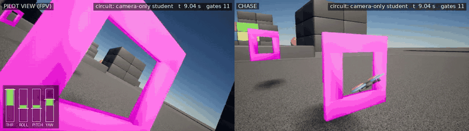
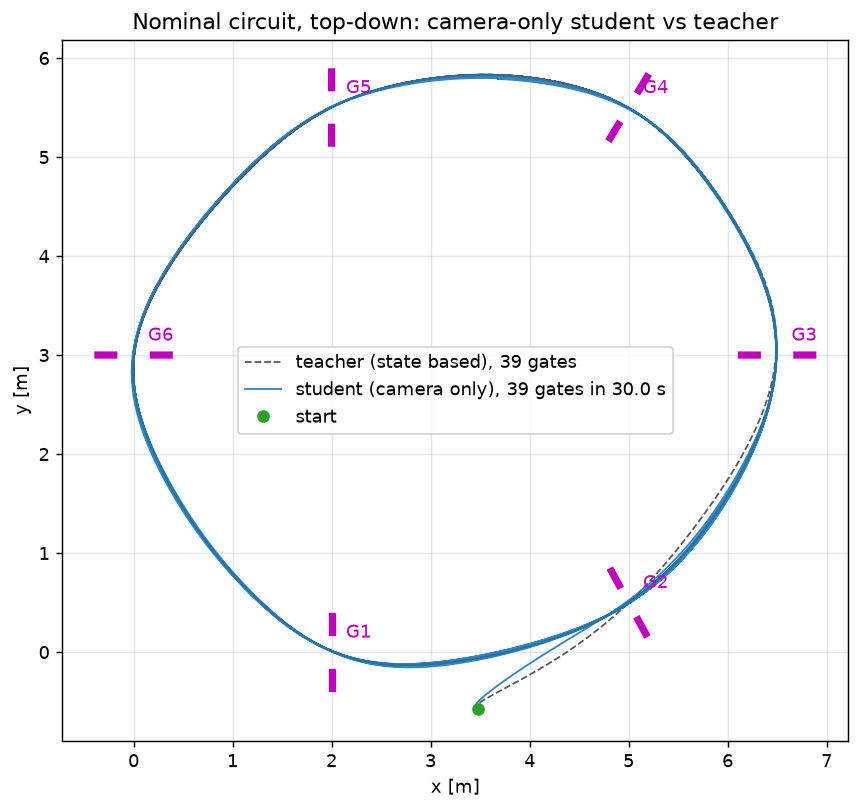
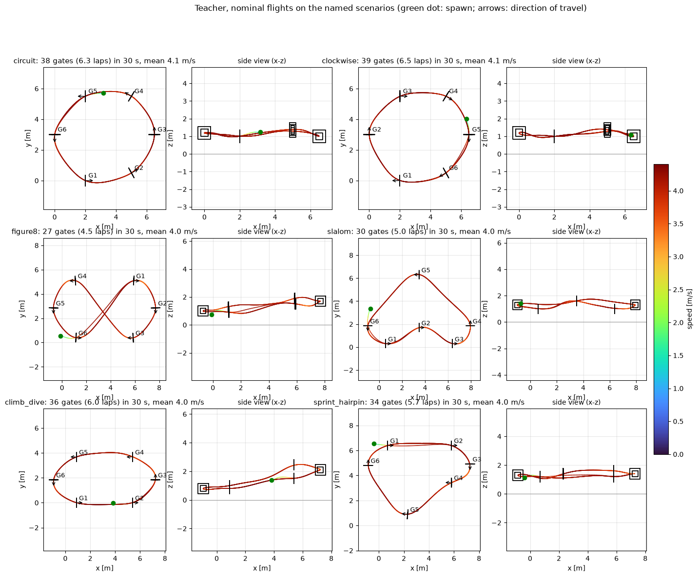
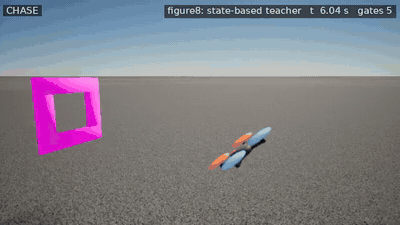
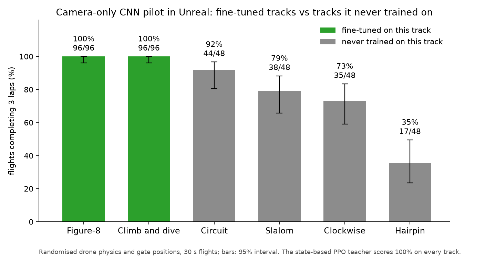
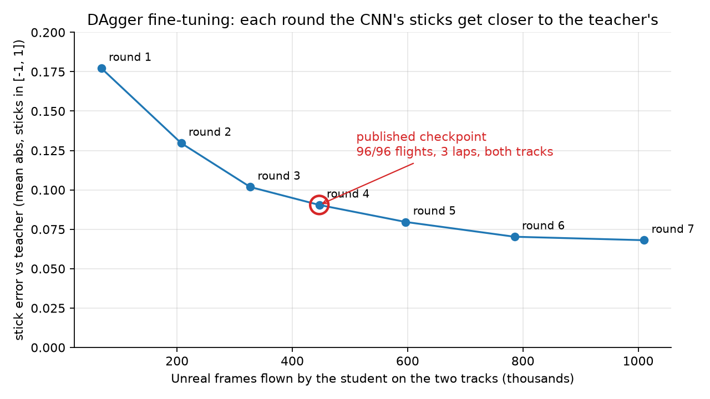
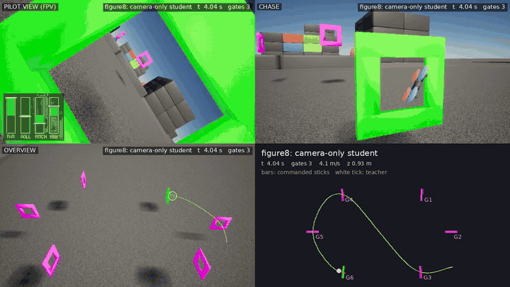
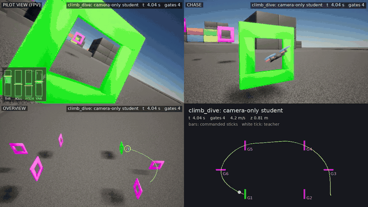
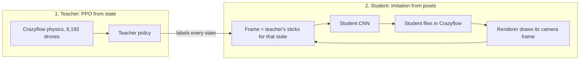

# FPV gate racing: PPO teacher, camera-only student

Goal: a network that races a quadrotor through gates from the FPV camera image alone, outputting the four stick
commands a human pilot sends (thrust and roll / pitch / yaw rate). Everything is simulation.

**Models and video:** https://huggingface.co/Abuudiii/fpv-gate-racing



Left: the student's own view in Unreal, the only thing it flies from. Bars: the sticks it commands; white tick: what
the teacher would have done. Right: a chase camera on the same flight (the drone model is drawn at twice its true
size; the student's view never contains it). Full videos with an overview camera are on the model page.

## Result

Closed loop in Unreal, student alone, 20 s per episode. The teacher flies the same layouts, physics and spawns.

| Pilot | Input | Randomised: ≥ 3 laps (192 held-out episodes) | Crashes | Lap time | Nominal circuit: ≥ 3 laps (24 episodes) |
|---|---|---|---|---|---|
| Student | 3 camera frames + its previous action | 95.8% (184) | 4.2% (8) | 4.60 s | 100% |
| Teacher | exact state (43 numbers) | 100% | 0% | 4.59 s | 100% |

"Randomised" draws a new gate layout (±0.3 m, ±0.2 rad per gate), mass, thrust, drag and command delay per episode.
All 8 student crashes are gate-frame hits; 7 happen in the first 4 seconds, before the third gate. The evaluation ran
216 randomised episodes (96.3% with three laps); the first 24 repeat the seed of an earlier evaluation whose flights
went into the training data, so the table leaves them out.



## Other track shapes

The student above knows one circuit. A second teacher, trained with PPO on randomly generated six-gate tracks, flies
six named tracks. Five of them it never trained on; the sixth, the original circuit, is where the teacher it
started from was trained. This is the state-based teacher; the camera students for these tracks follow below.

| Track | ≥ 3 laps (2,048 randomised episodes) | Lap time | Crashes per flight-minute with stick noise (std 0.2) |
|---|---|---|---|
| Circuit (the original) | 100% | 4.73 s | 0.009 |
| Clockwise | 100% | 4.70 s | 0.008 |
| Figure-8 | 100% | 6.71 s | 0.059 |
| Slalom | 100% | 6.21 s | 0.025 |
| Climb and dive | 100% | 5.07 s | 0.024 |
| Sprint into a hairpin | 100% | 5.41 s | 0.036 |
| Random tracks (what it trained on) | 100% | 5.92 s | 0.039 |





The track generator (`fpv.track.sample_tracks`) draws a new closed six-gate track for every episode: uneven loops in
both directions (straights into tight turns, weaves), two-lobe figure-eights, with height changes up to 1.8 m,
subject to spacing, turn-angle and clearance limits. The six named tracks (`fpv.track.SCENARIOS`) are not built into
it. How held-out they are differs: the figure-8 lies inside the generator's two-lobe family, so it is the weakest
test; the hairpin and the climb-and-dive are the furthest from the training mix. The slalom weaves through three of
its six gates, since a closed six-gate loop that keeps the next gate in view cannot weave all the way round.

What it took: starting from the single-circuit teacher (training from scratch on random tracks stalled at hovering), a
stronger reward for keeping the next gate in the camera's view, and then stronger stick noise in training, which
brought the crash rate under noise below 0.06 per flight-minute on every track.

## Camera student on the other tracks

A second camera student sees the last five frames, and **the next gate to fly through is drawn green** (the others
stay magenta): on a track it has not memorised, the image alone does not say which gate comes next. It was first
trained on randomly generated tracks only (831,000 Unreal frames), then **trained directly on two tracks, the
figure-8 and the climb-and-dive**, with DAgger in Unreal (about 447,000 frames flown on those two, four rounds,
mixed with the random-track frames at 30% of every batch).

| Track | Trained on it? | ≥ 3 laps, randomised episodes [95% interval] | Crashes | Lap time | Nominal track: ≥ 3 laps (24 episodes) |
|---|---|---|---|---|---|
| Figure-8 | yes | 100% of 96 [96, 100] | 0% | 6.74 s | 100% |
| Climb and dive | yes | 100% of 96 [96, 100] | 0% | 5.10 s | 100% |
| Circuit | no | 91.7% of 48 [80, 97] | 10.4% | 4.97 s | 100% |
| Slalom | no | 79.2% of 48 [66, 88] | 27.1% | 6.62 s | 87.5% |
| Clockwise | no | 72.9% of 48 [59, 83] | 33.3% | 5.10 s | 100% |
| Sprint into a hairpin | no | 35.4% of 48 [23, 50] | 72.9% | 6.44 s | 8.3% |

The two "yes" rows are the tuned checkpoint; the four "no" rows are the random-track checkpoint before that tuning,
shown as it flies, with no training on any of the four. The tuned checkpoint was not evaluated on them. One
evaluation pass per track in Unreal, 30 s episodes, randomised drone physics, gate positions and spawns; the teacher
completes three laps in every one of the same episodes. The tuned checkpoint was fixed on a separate selection seed
before the final pass. On the hairpin track 31 of 35 crashes are on the leg right after the hairpin.





Stick error after each fine-tuning round is measured on 8 flights, so it is a trend; the published checkpoint is
round 4, the one checked on the selection seed.





Checkpoints, evaluations and one video per track (first flight of a fixed seed, including the hairpin flight that
crashes) are on the model page under `tracks/student_two/` and `tracks/student_asis/`.

## How it works

PPO never sees a camera frame. A teacher learns to fly from exact state with PPO, and a CNN student then learns to
copy it from pixels by supervised learning.



| Piece | File | What it does |
|---|---|---|
| Physics | `fpv/env.py` | Gate-racing environment on [Crazyflow](https://github.com/learnsyslab/crazyflow) (batched JAX quadrotor sim, Crazyflie-class `cf21B_500`), 500 Hz physics, 50 Hz policy. It is the only dynamics in every stage. |
| Teacher | `fpv/ppo.py` | PPO in JAX. Input: velocity, attitude, body rates, corners of the next two gates, previous action. MLP 3 × 256. |
| Closed loop | `fpv/closed_loop.py` | Steps Crazyflow for an outside pilot and returns the teacher's action for the current state (the label). |
| Tracks | `fpv/track.py` | Gate geometry, the six named tracks and the random-track generator. |
| Renderers | `fpv/render_airsim.py`, `fpv/render_synth.py` | Draw the FPV frame for a given pose. [Project AirSim](https://github.com/iamaisim/ProjectAirSim) (Unreal Engine 5, 24 instances on 6 GPUs) or a fast JAX ray caster. Neither does any physics. The Unreal renderer can also draw a drone model with chase and overview cameras for videos. |
| Student | `fpv/student.py` | CNN, 2.43 M parameters. Input: last three 320×180 frames + its previous action. |
| DAgger | `fpv/dagger.py` | The student flies, drifts into states the teacher never visits, the teacher labels them, the student is retrained. |

Design choices that mattered:

- **Rate commands.** The policy outputs thrust + body rates, the interface FPV pilots and Betaflight use. Crazyflow's
  `body_rate` mode also levels the drone; the environment zeroes those gains (`kR`, `ki_m`), and
  `checks/crazyflow_check.py` tests the step response.
- **A teacher that tolerates a bad pilot.** The first teacher scored 100% on its own but crashed 3.4 times per
  flight-minute under moderate stick noise. Training with off-course starts and action noise cut that to 0.04, which
  is what makes its labels useful once the student drifts.
- **Synthetic pre-training.** Closed loop, Unreal renders about 90 frames/s across six GPUs here; the ray caster
  renders about 2,500 at the same resolution on one. The student learned to fly on the ray caster first. With the same first 171,000 Unreal frames, the pre-trained network
  completed three laps in 24 of 24 test episodes and one trained from scratch in none.
- **Lock-step rendering.** `scripts/test_render_airsim.py` checks that every frame belongs to the pose that was sent
  (0 mismatches in 32,000 frames under load) and that gates appear where the camera model predicts. The third-person
  views are checked the same way (0 of 3,840 frames matched a step other than their own).

## Setup

One node with 6× H100 and 96 cores. Python 3.12.

```bash
python3.12 -m venv .venv-sim && .venv-sim/bin/pip install crazyflow "jax[cuda12]" matplotlib imageio-ffmpeg
bash scripts/setup_airsim.sh     # Project AirSim v1.0.1 Blocks build + client venv, under $FPV_AIRSIM_ROOT
```

## Run

```bash
T=runs/teacher/cruise_wide_noise2_s1/ckpt_latest.pkl
F="ppo.total_steps=3e9 env.w_cam=0.1 env.w_crash=10 env.w_speed=0.05 env.speed_limit=4.0 env.p_wide=0.5"
UE='{"gpus":[0,1,2,3,4,5],"instances_per_gpu":4,"look":"stock"}'
R=runs/student/ue_a
py=.venv-sim/bin/python

# 1. teacher: off-course starts, then action noise on top (about 13 minutes each on one H100)
$py scripts/train_teacher.py --name cruise_wide_s1 --seed 1 --set $F
$py scripts/train_teacher.py --name cruise_wide_noise2_s1 --seed 21 --init runs/teacher/cruise_wide_s1/ckpt_latest.pkl \
    --set $F env.rand_action_noise=0.2 env.p_action_noise=0.5
$py scripts/eval_teacher.py $T

# 2. student on the synthetic renderer: once at the final resolution (weights), once at 160x90 (states to re-render)
D="--teacher $T --wide-spawn-p 0.3 --renderer synth --n-envs 256 --steps 600 --beta 1,0.5,0.3,0.15,0 --train-steps 6000,3000 --eval-episodes 256"
$py scripts/run_dagger.py --out runs/student/synth2_hr --rounds 10 $D --width 320 --height 180 --channels 32,64,96,128,192,192
$py scripts/run_dagger.py --out runs/student/synth3 --data-dir /tmp/fpv_student/synth3 --rounds 12 $D

# 3. the same states drawn by Unreal, then fine-tune the synthetic weights on them
$py scripts/rerender_dagger_shards.py --src /tmp/fpv_student/synth3 --out $R/data --renderer airsim \
    --renderer-args "$UE" --width 320 --height 180 --steps 600
$py scripts/train_student.py --data $R/data --init runs/student/synth2_hr/ckpt_r04.pkl --steps 8000 --out $R/pre_synth/ckpt.pkl
$py scripts/eval_student.py $R/pre_synth/ckpt.pkl --renderer airsim --renderer-args "$UE" --episodes 24 --nominal-episodes 0 \
    --steps 1000 --skip-teacher --sim-device cpu --save-data $R/data --save-round 12 --out $R/pre_synth/eval.json

# 4. three correction rounds flown by the student in Unreal
$py scripts/run_dagger.py --out $R --renderer airsim --renderer-args "$UE" --sim-device cpu --init $R/pre_synth/ckpt.pkl \
    --first-round 13 --rounds 16 --steps 0 --beta 0 --train-steps 3000 --eval-episodes 48 --eval-steps 1000 --eval-as-data --resume

# 5. final evaluation and video (pilot's view + chase + overview)
$py scripts/eval_student.py $R/ckpt_latest.pkl --renderer airsim --renderer-args "$UE" --episodes 216 --nominal-episodes 24 \
    --steps 1000 --sim-device cpu --out $R/best/eval.json
$py scripts/student_flight_video.py $R/ckpt_latest.pkl --teacher $T --renderer airsim --renderer-args "$UE" --sim-device cpu \
    --seed 2026 --scenario circuit --out $R/best/third_person

# 6. teacher for other track shapes: random tracks, starting from the circuit teacher
REC="env.w_crash=10 env.w_speed=0.05 env.speed_limit=4.0 env.p_wide=0.5 env.track=random env.w_cam=0.2"
$py scripts/train_teacher.py --name rt_D_cam02 --seed 105 --init $T \
    --set ppo.total_steps=3e9 $REC env.rand_action_noise=0.2 env.p_action_noise=0.5
$py scripts/train_teacher.py --name rt_G_D_noise3 --seed 108 --init runs/teacher/rt_D_cam02/ckpt_latest.pkl \
    --set ppo.total_steps=3e9 $REC env.rand_action_noise=0.3 env.p_action_noise=0.7
$py scripts/eval_teacher.py runs/teacher/rt_G_D_noise3/ckpt_latest.pkl --seed 7000 --records   # per-track metrics + flight records
$py scripts/flight_video.py runs/teacher/rt_G_D_noise3/records/*.npz --out runs/teacher/rt_G_D_noise3/videos --subdirs \
    --caption "{stem}: state-based teacher" --gpus 4 5 --ipg 4

# 7. camera student for other tracks (5 frames, next gate green): random tracks first, then the two tuned tracks
HL='{"gpus":[0],"instances_per_gpu":4,"look":"stock","highlight_target":true,"highlight_rgb":[0,1,0]}'
A=runs/student/ue_tracks/asis/ckpt.pkl          # round 21 of the random-track Unreal run
$py scripts/run_dagger.py --out runs/student/ue_tracks/two --train-scenarios figure8,climb_dive --init $A \
    --teacher runs/teacher/rt_G_D_noise3/ckpt_latest.pkl --renderer airsim --renderer-args "$HL" \
    --first-round 30 --rounds 60 --steps 1500 --beta 0 --train-steps 5000 --eval-episodes 8 --eval-steps 1500 \
    --eval-as-data --seed 500000 --wide-spawn-p 0.3 --extra-data <random-track data dirs> --extra-frac 0.3
$py scripts/extra_collect.py ...                # more collectors on the other GPUs, same checkpoint (see its docstring)
$py scripts/eval_student.py runs/student/ue_tracks/two/ckpt_r33.pkl --teacher runs/teacher/rt_G_D_noise3/ckpt_latest.pkl \
    --renderer airsim --renderer-args "$HL" --scenarios figure8 --episodes 96 --nominal-episodes 24 --seed 950001
```

Step 3 also evaluated a from-scratch network the same way, and both evaluations were stored as round 12 of the data.
Because that step and step 5 use `eval_student.py`'s default seed, pass a different `--seed` in one of them to keep
all final episodes held out. `scripts/node_step.sh` and `scripts/sync_*.sh` run the above as Slurm job steps from a
laptop (`LOGIN`, `JOB`, `NODE_DIR`).

## Limits

- The single-circuit student knows one circuit. The five-frame student was tuned on two tracks only, needs the next
  gate drawn green, and its untuned version is weak on the hairpin track.
- One Unreal scene (Blocks). Another look is untested.
- Cruise speed, about 4 m/s; this is not aggressive racing.
- Simulation only: no real flight-controller firmware, no real camera.
- Unreal instances sometimes failed to start when 24 were launched together. The renderer now retries failed
  instances one by one (no retry was needed in 120 later launches, and a forced failure is retried as designed).
